<div align="center">

# CORPORACIÓN UNIFICADA NACIONAL DE EDUCACIÓN SUPERIOR — CUN

**Programa:** Ingeniería de Sistemas<br>
**Asignatura:** Programación Avanzada

&nbsp;

# SISTEMA DE GESTIÓN DE BIBLIOTECA

### Documentación técnica — ACA Final 2026

&nbsp;

**Estudiante:** Marlon Fabián Moncaleano Núñez<br>
**Tecnologías:** C# · Windows Forms (.NET 10) · SQL Server<br>
**Fecha:** Noviembre de 2026

</div>

<div style="page-break-after: always;"></div>

<!-- TOC-INICIO -->
## Tabla de contenido

1. [Introducción](#1-introducción)
2. [Objetivos](#2-objetivos)
3. [Planteamiento del problema](#3-planteamiento-del-problema)
4. [Análisis de requerimientos](#4-análisis-de-requerimientos)
5. [Casos de uso](#5-casos-de-uso)
6. [Diagrama de clases](#6-diagrama-de-clases)
7. [Modelo entidad-relación](#7-modelo-entidad-relación)
8. [Diccionario de datos](#8-diccionario-de-datos)
9. [Arquitectura del sistema](#9-arquitectura-del-sistema)
10. [Explicación de los módulos desarrollados](#10-explicación-de-los-módulos-desarrollados)
11. [Descripción de la conexión con SQL Server](#11-descripción-de-la-conexión-con-sql-server)
12. [Validaciones y manejo de excepciones](#12-validaciones-y-manejo-de-excepciones)
13. [Capturas de pantalla del sistema](#13-capturas-de-pantalla-del-sistema)
14. [Pruebas de funcionamiento](#14-pruebas-de-funcionamiento)
15. [Control de versiones con Git y GitHub](#15-control-de-versiones-con-git-y-github)
16. [Conclusiones](#16-conclusiones)
17. [Recomendaciones](#17-recomendaciones)
18. [Referencias bibliográficas](#18-referencias-bibliográficas)

> **Numeración de páginas:** el formato Markdown no tiene paginación. La versión en PDF (`Informe Bbiblioteca app.pdf`) incluye la misma información con número de página en el pie.
<!-- TOC-FIN -->

<div style="page-break-after: always;"></div>

## 1. Introducción

Las instituciones educativas manejan un volumen creciente de material bibliográfico y de usuarios que lo consultan. Cuando el control de libros, autores, editoriales y préstamos se hace en hojas de cálculo o de forma manual, aparecen duplicados, existencias que no coinciden con la realidad y préstamos sin trazabilidad.

Este documento describe el diseño, la implementación y las pruebas del **Sistema de Gestión de Biblioteca**, una aplicación de escritorio desarrollada con **C#, Windows Forms y SQL Server**. El sistema permite administrar libros, autores, editoriales y usuarios (operaciones de registro, consulta, actualización y eliminación), controlar préstamos y devoluciones con actualización automática de existencias, y consultar reportes.

El código aplica los principios de la **Programación Orientada a Objetos** y una **arquitectura por capas** (Presentación, Lógica de negocio, Acceso a datos y Base de datos), con consultas parametrizadas, validación de datos y manejo de excepciones.

## 2. Objetivos

### 2.1 Objetivo general

Desarrollar una aplicación de escritorio para la gestión integral de una biblioteca utilizando C#, Windows Forms y SQL Server, que permita administrar libros, autores, editoriales y usuarios, gestionar préstamos y devoluciones, y generar reportes mediante operaciones conectadas a una base de datos relacional, aplicando los principios de la Programación Orientada a Objetos.

### 2.2 Objetivos específicos

- Aplicar los principios de Programación Orientada a Objetos (clases, objetos, constructores, encapsulamiento, herencia y polimorfismo).
- Diseñar una base de datos relacional normalizada con claves primarias, foráneas y restricciones de integridad.
- Implementar operaciones CRUD para libros, autores, editoriales, usuarios y préstamos.
- Utilizar SQL Server como gestor de base de datos, incluyendo vistas para los reportes.
- Implementar una arquitectura por capas con separación física en carpetas y espacios de nombres.
- Validar la información ingresada por el usuario y manejar excepciones con mensajes claros.
- Utilizar Git y GitHub como sistema de control de versiones.
- Documentar técnicamente el proyecto.
- Implementar formularios que permitan administrar la información de libros, autores, editoriales y usuarios.

## 3. Planteamiento del problema

Una institución educativa requiere una aplicación de escritorio que facilite la administración de los procesos de su biblioteca. La gestión de libros, autores, editoriales y usuarios, así como el control de préstamos y devoluciones, necesita un sistema organizado que permita registrar, consultar, actualizar y eliminar información, hacer seguimiento al estado de los préstamos y generar reportes.

Sin un sistema centralizado se presentan los siguientes problemas:

- **Inconsistencia de inventario:** no se sabe cuántos ejemplares hay realmente disponibles.
- **Datos duplicados o erróneos:** usuarios o libros registrados varias veces, ISBN repetidos, correos inválidos.
- **Falta de trazabilidad:** no se conoce quién tiene un libro, desde cuándo, ni el historial de préstamos.
- **Dificultad para consultar:** obtener un listado consolidado exige revisar archivos manualmente.

La solución propuesta es un sistema de escritorio que centraliza la información en SQL Server, valida los datos antes de almacenarlos y garantiza la integridad entre libros, usuarios y préstamos.

## 4. Análisis de requerimientos

### 4.1 Requerimientos funcionales

| Código | Requerimiento | Implementación |
|---|---|---|
| RF01 | **Gestión de libros:** registrar, listar, editar, eliminar y buscar (código/ISBN, título, autor); relacionar con autor y editorial; consultar existencias | `FormLibros`, `LibroBLL`, `LibroDAL` |
| RF02 | **Gestión de autores:** registrar, listar, editar y eliminar (si no tienen libros) | `FormAutores`, `AutorBLL`, `AutorDAL` |
| RF03 | **Gestión de editoriales:** registrar, listar, editar y eliminar (si no tienen libros) | `FormEditoriales`, `EditorialBLL`, `EditorialDAL` |
| RF04 | **Gestión de usuarios:** registrar, listar, editar y eliminar (si no tienen préstamos) | `FormUsuarios`, `UsuarioBLL`, `UsuarioDAL` |
| RF05 | **Gestión de préstamos:** registrar préstamo (usuario + libro + fecha), consultar, editar fechas, eliminar y filtrar por estado | `FormPrestamos`, `PrestamoBLL`, `PrestamoDAL` |
| RF06 | **Gestión de devoluciones:** registrar devolución, actualizar fecha, estado «Devuelto» y existencias del libro | `PrestamoDAL.RegistrarDevolucion` (transacción) |
| RF07 | **Consultas y reportes:** 9 reportes basados en vistas SQL, con exportación a CSV | `FormReportes`, `ReporteBLL`, `ReporteDAL` |
| RF08 | **Navegación:** formulario principal con acceso a Inicio, Libros, Usuarios, Autores, Editoriales, Préstamos y Reportes | `FormPrincipal` |

### 4.2 Requerimientos no funcionales

| Requerimiento | Cómo se cumple |
|---|---|
| Interfaz clara y organizada | Menú lateral con iconos, encabezado con la descripción de cada módulo y formularios con la misma distribución (datos a la izquierda, búsqueda y tabla a la derecha). Colores y estilos centralizados en `Tema` |
| Facilidad de uso | Texto guía en los campos, ayudas emergentes, atajos de teclado (F5, Ctrl+N, Ctrl+G, Supr), filtros que se aplican al cambiarlos, estado del préstamo con color y accesos rápidos en Inicio |
| Validación de campos obligatorios | `Validador` en la capa de negocio y restricciones `NOT NULL` en la base de datos |
| Prevención de duplicados | Restricciones `UNIQUE` (ISBN, ISBN sin guiones, documento, correos, nombre de editorial, nombre y apellido de autor) con mensajes claros |
| Mensajes claros | Clase `Mensajes`; las excepciones SQL se traducen en `ConexionBD.Traducir` |
| Manejo adecuado de excepciones | `ReglaNegocioException` para errores esperados; `FormCrudBase.Ejecutar` captura todo y evita que la aplicación se cierre |
| Código organizado y legible | Carpetas por capa, espacios de nombres por capa, nombres descriptivos |
| Integridad de datos | PK, FK, `CHECK`, transacciones en préstamos y devoluciones |
| Conexión con SQL Server | `ConexionBD` + cadena en `App.config` |
| Consultas parametrizadas | Todas las consultas usan `SqlParameter`; los filtros `LIKE` escapan los comodines |
| Separación de responsabilidades | Los formularios no contienen SQL; el acceso a datos no contiene reglas de interfaz |

### 4.3 Reglas de negocio implementadas

1. Un libro no se puede prestar si no tiene existencias disponibles.
2. Un usuario puede tener como máximo **3 préstamos activos** simultáneos.
3. Un usuario no puede tener dos préstamos activos del mismo libro.
4. Al registrar un préstamo se descuenta una unidad del stock; al devolver se repone. Ambas acciones ocurren en una **transacción**.
5. Un préstamo ya devuelto no se puede devolver de nuevo (evita inflar el stock).
6. La fecha de devolución no puede ser anterior a la del préstamo ni futura; un préstamo «Prestado» no tiene fecha de devolución y uno «Devuelto» siempre la tiene (también garantizado por la restricción `CK_Prestamos_Coherencia`).
7. Al eliminar un préstamo activo se repone el stock del libro.
8. No se puede eliminar un libro con préstamos activos ni con historial, ni un autor/editorial con libros, ni un usuario con préstamos.
9. El campo **Stock** representa los ejemplares **disponibles** en este momento (ya descuenta los prestados). Si se cambia a mano en un libro con préstamos activos, el sistema lo explica y pide confirmación.
10. Las reglas 1 a 3 se comprueban **dentro de la transacción** del préstamo, con bloqueo de los registros involucrados, para que dos préstamos simultáneos no puedan saltárselas.
11. Al actualizar un libro no se sobrescribe un stock que haya cambiado mientras se editaba (por un préstamo o una devolución); se avisa al usuario para que lo revise.
12. No se puede registrar dos veces el mismo autor (nombre y apellido) ni el mismo ISBN escrito con o sin guiones.

## 5. Casos de uso

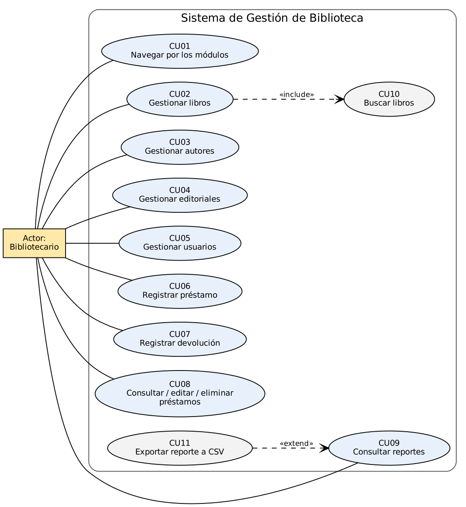

| Caso de uso | Actor | Flujo principal | Flujos alternos |
|---|---|---|---|
| **CU01 Navegar por los módulos** | Bibliotecario | Selecciona un módulo en el menú lateral y el sistema carga su formulario | Si no hay conexión con SQL Server se muestra una advertencia |
| **CU02 Gestionar libros** | Bibliotecario | Completa ISBN, título, autor, editorial, año y existencias → Guardar. Selecciona una fila para Actualizar o Eliminar | ISBN duplicado, autor inexistente, año fuera de rango o libro con préstamos: se muestra el motivo y no se modifica nada |
| **CU03 Gestionar autores** | Bibliotecario | Registra nombre, apellido y nacionalidad; edita o elimina | No se elimina un autor con libros |
| **CU04 Gestionar editoriales** | Bibliotecario | Registra nombre, teléfono y correo; edita o elimina | Nombre o correo duplicado; editorial con libros |
| **CU05 Gestionar usuarios** | Bibliotecario | Registra documento, nombre, apellido, teléfono y correo; edita o elimina | Documento o correo duplicado; correo inválido; usuario con préstamos |
| **CU06 Registrar préstamo** | Bibliotecario | Elige usuario, libro y fecha → «Registrar préstamo»; el sistema valida, registra y descuenta stock | Sin existencias, máximo de préstamos alcanzado, libro ya prestado al usuario |
| **CU07 Registrar devolución** | Bibliotecario | Selecciona un préstamo activo → «Registrar devolución»; se guarda la fecha, el estado pasa a «Devuelto» y el stock aumenta | El préstamo ya estaba devuelto |
| **CU08 Consultar, editar y eliminar préstamos** | Bibliotecario | Filtra por estado o texto; edita fechas o elimina | Estado y fechas incoherentes se rechazan |
| **CU09 Consultar reportes** | Bibliotecario | Elige un reporte y el sistema lo muestra en una tabla | Reporte vacío: se muestra 0 registros |
| **CU10 Buscar libros** | Bibliotecario | Elige criterio (Todos, ISBN, Título, Autor), escribe el texto y busca | Sin coincidencias: tabla vacía |
| **CU11 Exportar reporte a CSV** | Bibliotecario | Pulsa «Exportar a CSV» y elige la ruta del archivo | Sin datos o error de escritura: se informa al usuario |

## 6. Diagrama de clases

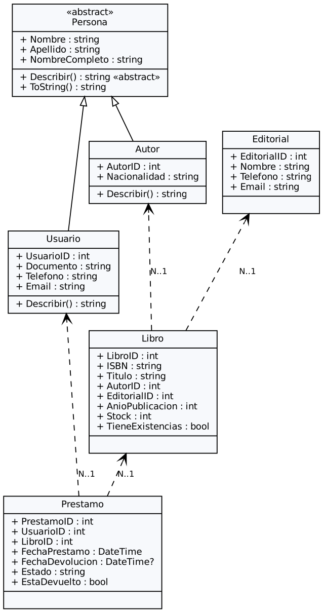

**Aplicación de POO en el código:**

| Concepto | Dónde se evidencia |
|---|---|
| **Clases y objetos** | `Autor`, `Usuario`, `Editorial`, `Libro`, `Prestamo`, DAL, BLL y formularios |
| **Constructores** | Constructor vacío y constructor con parámetros en cada entidad; constructores de los formularios que construyen la interfaz |
| **Encapsulamiento y propiedades** | Propiedades automáticas en las entidades; campos privados `readonly` en DAL/BLL/formularios; propiedades calculadas como `NombreCompleto`, `TieneExistencias` y `EstaDevuelto` |
| **Herencia** | `Autor` y `Usuario` heredan de `Persona` (comparten nombre y apellido). `FormLibros`, `FormAutores`, `FormEditoriales`, `FormUsuarios` y `FormPrestamos` heredan de `FormCrudBase` |
| **Polimorfismo** | `Persona.Describir()` es abstracto y cada subclase lo especializa. `FormCrudBase` declara métodos abstractos (`Guardar`, `Actualizar`, `Eliminar`, `Refrescar`…) que cada módulo implementa, y la clase base los invoca sin conocer el módulo concreto. Los ganchos virtuales (`PrepararControles`, `ConfirmarActualizacion`, `MensajeConfirmarEliminar`…) permiten que un módulo cambie solo la parte que necesita; por ejemplo, Libros sobrescribe `ConfirmarActualizacion` para pedir confirmación al cambiar existencias |
| **Colecciones** | `Dictionary<string,string>` con los mensajes de restricciones y los títulos de columna, `List<int>` en las pruebas, arreglos de criterios/estados, `DataTable` para listados |
| **Uso de `DataTable` en el acceso a datos** | Los DAL devuelven `DataTable` para las consultas de listado porque se enlazan directamente a las grillas; las entidades se usan para enviar datos a la base (registrar y actualizar). Es una decisión deliberada para mantener la capa de presentación simple |
| **Organización de responsabilidades** | Entidades (datos), DAL (SQL), BLL (reglas), formularios (interfaz) |

## 7. Modelo entidad-relación

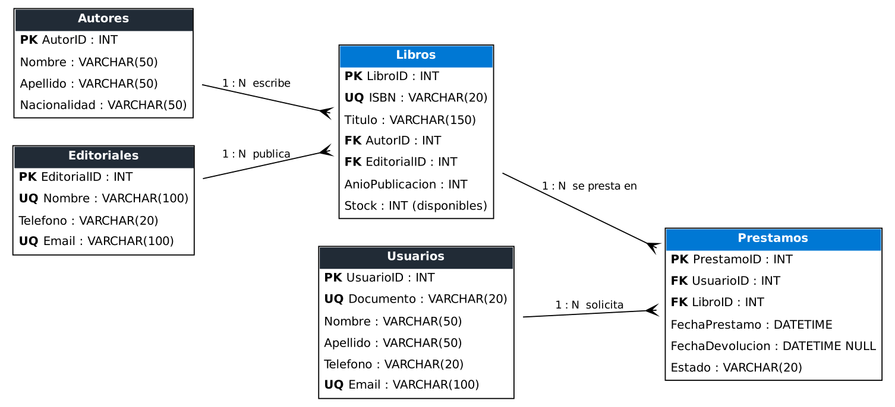

**Relaciones:**

- Un **autor** escribe muchos **libros**; cada libro tiene un autor (1:N).
- Una **editorial** publica muchos **libros**; cada libro tiene una editorial (1:N).
- Un **usuario** puede tener muchos **préstamos**; cada préstamo pertenece a un usuario (1:N).
- Un **libro** puede aparecer en muchos **préstamos**; cada préstamo es de un libro (1:N).

Las relaciones entre Usuarios y Libros (N:M) se resuelven con la tabla **Prestamos**, que además guarda las fechas y el estado. No se necesita una tabla `DetallePrestamos` porque cada préstamo corresponde a un solo libro.

## 8. Diccionario de datos

Base de datos: `BibliotecaDB` (SQL Server). Los nombres de las restricciones coinciden con los del script `sql/Script_Biblioteca_Completo.sql`.

### 8.1 Autores

| Campo | Tipo | Nulo | Restricción | Descripción |
|---|---|---|---|---|
| `AutorID` | INT IDENTITY(1,1) | No | PK `PK_Autores` | Identificador único del autor |
| `Nombre` | VARCHAR(50) | No | | Nombre del autor |
| `Apellido` | VARCHAR(50) | No | | Apellido del autor |
| `Nacionalidad` | VARCHAR(50) | No | | País de origen |

Restricción adicional `UQ_Autores_NombreApellido`: no puede haber dos autores con el mismo nombre y apellido (la intercalación no distingue mayúsculas).

### 8.2 Editoriales

| Campo | Tipo | Nulo | Restricción | Descripción |
|---|---|---|---|---|
| `EditorialID` | INT IDENTITY(1,1) | No | PK `PK_Editoriales` | Identificador único |
| `Nombre` | VARCHAR(100) | No | UNIQUE `UQ_Editoriales_Nombre` | Nombre de la editorial |
| `Telefono` | VARCHAR(20) | No | | Teléfono de contacto |
| `Email` | VARCHAR(100) | No | UNIQUE `UQ_Editoriales_Email`; CHECK `CK_Editoriales_Email` (formato) | Correo de contacto |

### 8.3 Libros

| Campo | Tipo | Nulo | Restricción | Descripción |
|---|---|---|---|---|
| `LibroID` | INT IDENTITY(1,1) | No | PK `PK_Libros` | Identificador único |
| `ISBN` | VARCHAR(20) | No | UNIQUE `UQ_Libros_ISBN` | Código del libro |
| `Titulo` | VARCHAR(150) | No | Índice `IX_Libros_Titulo` | Título |
| `AutorID` | INT | No | FK `FK_Libros_Autores` → Autores | Autor del libro |
| `EditorialID` | INT | No | FK `FK_Libros_Editoriales` → Editoriales | Editorial del libro |
| `AnioPublicacion` | INT | No | CHECK `CK_Libros_Anio` (1001–2100); la aplicación limita al año actual | Año de publicación |
| `Stock` | INT | No | DEFAULT 1; CHECK `CK_Libros_Stock` (≥ 0) | Ejemplares **disponibles** |
| `ISBNSinGuiones` | VARCHAR(20), calculada y persistida: `REPLACE(ISBN, '-', '')` | No | UNIQUE `UQ_Libros_ISBNSinGuiones` | Evita registrar el mismo ISBN con y sin guiones |

### 8.4 Usuarios

| Campo | Tipo | Nulo | Restricción | Descripción |
|---|---|---|---|---|
| `UsuarioID` | INT IDENTITY(1,1) | No | PK `PK_Usuarios` | Identificador único |
| `Documento` | VARCHAR(20) | No | UNIQUE `UQ_Usuarios_Documento` | Cédula / identificación |
| `Nombre` | VARCHAR(50) | No | | Nombre |
| `Apellido` | VARCHAR(50) | No | | Apellido |
| `Telefono` | VARCHAR(20) | No | | Teléfono |
| `Email` | VARCHAR(100) | No | UNIQUE `UQ_Usuarios_Email`; CHECK `CK_Usuarios_Email` (formato) | Correo electrónico |

### 8.5 Prestamos

| Campo | Tipo | Nulo | Restricción | Descripción |
|---|---|---|---|---|
| `PrestamoID` | INT IDENTITY(1,1) | No | PK `PK_Prestamos` | Identificador único |
| `UsuarioID` | INT | No | FK `FK_Prestamos_Usuarios` → Usuarios | Usuario que recibe el libro |
| `LibroID` | INT | No | FK `FK_Prestamos_Libros` → Libros | Libro prestado |
| `FechaPrestamo` | DATETIME | No | DEFAULT GETDATE() | Fecha y hora del préstamo |
| `FechaDevolucion` | DATETIME | Sí | | Fecha y hora de devolución (nula mientras esté prestado) |
| `Estado` | VARCHAR(20) | No | DEFAULT 'Prestado'; CHECK `CK_Prestamos_Estado` ('Prestado', 'Devuelto') | Estado del préstamo |

Restricción adicional `CK_Prestamos_Coherencia`: `Prestado` exige `FechaDevolucion` nula; `Devuelto` exige fecha de devolución mayor o igual a la fecha de préstamo.

### 8.6 Vistas de reporte

| Vista | Contenido |
|---|---|
| `VISTA_InventarioLibros` | Libros con autor, editorial, año y ejemplares disponibles |
| `VISTA_ResumenAutores` | Autores con cantidad de libros registrados |
| `VISTA_ResumenEditoriales` | Editoriales con cantidad de libros registrados |
| `VISTA_PrestamosActivos` | Préstamos en estado «Prestado» con usuario, libro y autor |
| `VISTA_HistorialPrestamos` | Todos los préstamos con usuario, libro, fechas y estado |
| `VISTA_LibrosMasPrestados` | Cantidad total de préstamos por libro |
| `VISTA_ResumenGeneral` | Indicadores consolidados (títulos, ejemplares, autores, editoriales, usuarios, préstamos activos y devueltos) |

## 9. Arquitectura del sistema

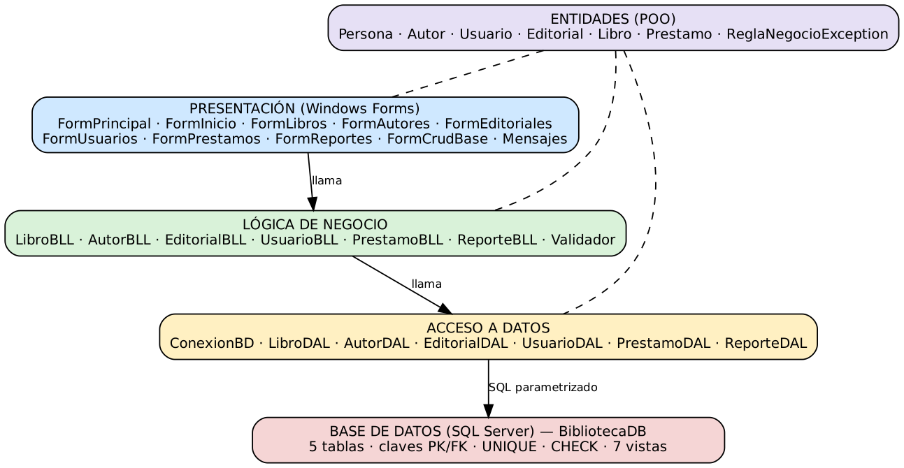

La separación en capas es **física** (carpetas y espacios de nombres distintos dentro del proyecto de Visual Studio) y **lógica** (cada capa solo conoce a la inferior).

```text
BibliotecaApp/
  Entidades/       BibliotecaApp.Entidades      Persona, Autor, Usuario, Editorial, Libro, Prestamo, ReglaNegocioException
  AccesoDatos/     BibliotecaApp.AccesoDatos    ConexionBD, AutorDAL, EditorialDAL, LibroDAL, UsuarioDAL, PrestamoDAL, ReporteDAL
  LogicaNegocio/   BibliotecaApp.LogicaNegocio  Validador, AutorBLL, EditorialBLL, LibroBLL, UsuarioBLL, PrestamoBLL, ReporteBLL
  Presentacion/    BibliotecaApp.Presentacion   FormPrincipal, FormInicio, FormCrudBase, FormLibros, FormAutores,
                                                FormEditoriales, FormUsuarios, FormPrestamos, FormReportes, Mensajes, Tema
BibliotecaApp.Pruebas/                          Pruebas automáticas (referencia al proyecto principal)
```

| Capa | Responsabilidad |
|---|---|
| **Presentación** | Formularios y controles, captura de datos, mensajes al usuario. No contiene SQL |
| **Lógica de negocio** | Validación de datos, reglas del sistema (máximo de préstamos, duplicados activos, rangos) y coordinación de las operaciones |
| **Acceso a datos** | Conexión con SQL Server, consultas parametrizadas, transacciones y traducción de errores SQL |
| **Base de datos** | Tablas, relaciones, restricciones de integridad y vistas de reportes |
| **Entidades** | Modelo de objetos compartido por las capas |

**Flujo de una operación** (ejemplo: registrar préstamo): `FormPrestamos.Guardar()` → `PrestamoBLL.RegistrarPrestamo()` valida datos y fechas y hace una comprobación rápida de las reglas → `PrestamoDAL.RegistrarPrestamo()` abre una transacción, verifica que el usuario exista, bloquea sus préstamos activos y vuelve a comprobar el máximo y el libro repetido, bloquea la fila del libro y verifica existencias, inserta el préstamo y descuenta el stock → `Commit`. Ante cualquier error se hace `Rollback` y la excepción sube hasta `FormCrudBase.Ejecutar`, que muestra el mensaje.

## 10. Explicación de los módulos desarrollados

### 10.1 Inicio (`FormInicio`)
Siete tarjetas de indicadores tomadas de `VISTA_ResumenGeneral`, cada una con su color e icono; al hacer clic en una se abre el módulo correspondiente (la de préstamos activos abre Préstamos filtrado en «Prestado»). Debajo hay **accesos rápidos**: Registrar préstamo, Registrar devolución (abre los préstamos activos), Nuevo libro y Ver reportes.

### 10.2 Formulario principal y navegación (`FormPrincipal`)
Menú lateral con el nombre del sistema, un icono por módulo, una barra que marca el módulo activo y efecto al pasar el ratón. El encabezado muestra el título y una descripción del módulo, y la barra de estado indica la conexión con SQL Server y la fecha y hora. Cada módulo se crea al seleccionarlo y se libera al cambiar, de modo que las listas desplegables siempre muestran datos actualizados. El método `IrA(nombre)` permite abrir un módulo desde otro formulario (lo usa Inicio).

### 10.3 Libros (`FormLibros`)
Campos: ISBN, título, autor y editorial (listas desplegables cargadas desde la base de datos), año de publicación y ejemplares disponibles. Búsqueda por **Todos, Código (ISBN), Título o Autor**; la tabla se actualiza al cambiar el criterio. Valida la unicidad del ISBN (con o sin guiones), que autor y editorial existan, el rango del año y las existencias. No permite eliminar libros con préstamos. Si se cambian los ejemplares disponibles de un libro con préstamos activos, explica que los prestados ya están descontados y pide confirmación; además, no sobrescribe un stock que haya cambiado mientras se editaba. Los libros sin existencias se muestran en rojo.

### 10.4 Autores (`FormAutores`) y Editoriales (`FormEditoriales`)
CRUD con búsqueda. Los nombres de personas solo admiten letras, espacios, apóstrofes, puntos y guiones. En editoriales se valida teléfono, correo y unicidad de nombre y correo. La eliminación se bloquea con un mensaje claro si hay libros relacionados.

### 10.5 Usuarios (`FormUsuarios`)
CRUD con búsqueda por documento, nombre, apellido o correo. El documento debe tener solo dígitos (5 a 20) y ser único; el correo se valida por formato y unicidad.

### 10.6 Préstamos y devoluciones (`FormPrestamos`)
- **Registrar préstamo:** se elige usuario, libro y fecha; el estado inicia en «Prestado» y el stock baja en uno.
- **Registrar devolución:** se selecciona un préstamo activo; se guarda fecha y hora, el estado pasa a «Devuelto» y el stock sube en uno.
- **Actualizar fechas:** se corrigen las fechas manteniendo la coherencia con el estado. El usuario y el libro de un préstamo existente no se modifican para no descuadrar el inventario; si hay un error se elimina y se registra de nuevo.
- **Eliminar:** si el préstamo estaba activo, la unidad vuelve al stock.
- **Filtro** por estado (Todos, Prestado, Devuelto), que se aplica al cambiarlo, y búsqueda por documento, nombre, título o ISBN.
- El estado se muestra como etiqueta de color: **ámbar** para «Prestado» y **verde** para «Devuelto». La tabla muestra solo la fecha; la hora exacta aparece en el formulario al seleccionar el préstamo.
- «Registrar devolución» solo se habilita con un préstamo activo seleccionado.

### 10.7 Reportes (`FormReportes`)
Nueve reportes: resumen consolidado, libros, autores, editoriales, usuarios, préstamos activos, préstamos devueltos, historial y libros más prestados. Incluye **exportación a CSV** (UTF-8 con BOM, separador `;`, compatible con Excel).

### 10.8 Clase base `FormCrudBase`
Construye la interfaz común de los módulos CRUD y centraliza: manejo de excepciones, habilitación de botones (Guardar solo para registros nuevos; Actualizar y Eliminar solo con un registro seleccionado), confirmación antes de eliminar y refresco de la tabla. También ofrece texto guía en la búsqueda, ayudas emergentes en los botones y atajos de teclado: **F5** recargar, **Ctrl+N** nuevo, **Ctrl+G** guardar o actualizar y **Supr** eliminar (con el foco en la tabla). Al abrir un módulo el formulario queda listo para un registro nuevo, sin filas seleccionadas.

### 10.9 Estilos compartidos (`Tema`)
Clase estática con la paleta de colores, las fuentes, los iconos (fuente *Segoe MDL2 Assets*, incluida en Windows) y los métodos que dan estilo a botones y grillas: títulos de columna legibles («Año» en lugar de «AnioPublicacion»), anchos mínimos, formato de fecha y un aspecto distinto para los botones deshabilitados. Todos los formularios la usan, de modo que la apariencia se cambia en un solo lugar.

## 11. Descripción de la conexión con SQL Server

La clase `ConexionBD` (capa de acceso a datos) es el único punto que conoce la cadena de conexión, que se lee de `App.config`:

```xml
<connectionStrings>
  <add name="BibliotecaDB"
       connectionString="Server=.\SQLEXPRESS;Database=BibliotecaDB;Integrated Security=True;TrustServerCertificate=True;Connect Timeout=10;"
       providerName="Microsoft.Data.SqlClient" />
</connectionStrings>
```

- Se usa el paquete **Microsoft.Data.SqlClient** (el proveedor actual de Microsoft para SQL Server).
- `ConexionBD` ofrece `Consultar`, `Ejecutar` y `Escalar`, que abren y cierran la conexión con `using` y siempre reciben parámetros (`SqlParameter`), lo que previene inyección SQL. Los textos de búsqueda se escapan con `PatronLike` para que `%`, `_` y `[` se traten como texto.
- `PrestamoDAL` usa `SqlTransaction` para que el préstamo (o la devolución) y el cambio de stock se apliquen juntos o no se apliquen. Un único método auxiliar (`EnTransaccion`) abre la transacción con `using`, confirma al final y, ante cualquier error, hace `Rollback` sin perder la excepción original aunque el `Rollback` también falle. La lectura del libro usa `UPDLOCK, ROWLOCK` y la de los préstamos activos del usuario `UPDLOCK, HOLDLOCK`, para que dos préstamos simultáneos no consuman la misma existencia ni superen el máximo.
- `ConexionBD.Traducir` convierte los errores de SQL Server en mensajes comprensibles: errores de conexión (números 2, 53, 4060, 18456…), duplicados (2627/2601) y violaciones de claves foráneas o `CHECK` (547). La restricción se identifica por su **nombre exacto** entre comillas en el mensaje de SQL Server (funciona con mensajes en español o en inglés).
- `ProbarConexion` se ejecuta al abrir la aplicación y muestra el resultado en la barra de estado.

**Para ejecutar el sistema:** se necesita el runtime **.NET 10 Desktop** (o el SDK) y SQL Server. Ejecutar `sql/Script_Biblioteca_Completo.sql` (en SSMS o con `sqlcmd`) y, si la instancia no es `.\SQLEXPRESS`, ajustar `Server` en `App.config` (`localhost` para la instancia por defecto o `(localdb)\MSSQLLocalDB`). El script fija `QUOTED_IDENTIFIER` y `ANSI_NULLS`, que requiere la columna calculada de Libros, y usa fechas en formato ISO 8601 para funcionar con servidores en cualquier idioma. **Atención:** si `BibliotecaDB` ya existe, el script la borra y la vuelve a crear.

## 12. Validaciones y manejo de excepciones

| Entidad | Validaciones (capa de negocio) | Refuerzo en la base de datos |
|---|---|---|
| **Libros** | ISBN obligatorio, 10–20 caracteres (dígitos, guiones, X final); título obligatorio ≤ 150; autor y editorial seleccionados y existentes; año entre 1001 y el año actual; existencias entre 0 y 100000; confirmación al cambiar existencias con préstamos activos; stock no sobrescrito si cambió durante la edición | `UNIQUE` en ISBN y en ISBN sin guiones, `CHECK` de año y stock, FK |
| **Autores** | Nombre, apellido y nacionalidad obligatorios, ≤ 50, solo letras | `NOT NULL`, `UNIQUE` en nombre + apellido |
| **Editoriales** | Nombre ≤ 100; teléfono de 7 a 20 dígitos; correo válido ≤ 100 | `UNIQUE` en nombre y correo, `CHECK` de correo |
| **Usuarios** | Documento numérico 5–20; nombre y apellido solo letras; teléfono 7–20 dígitos; correo válido | `UNIQUE` en documento y correo, `CHECK` de correo |
| **Préstamos** | Usuario y libro seleccionados y existentes; fechas no futuras; devolución ≥ préstamo; existencias; máximo de préstamos activos; sin duplicar libro activo (las tres últimas se verifican dentro de la transacción) | FK, `CHECK` de estado y coherencia, transacciones con bloqueo |

**Manejo de excepciones:**

- `ReglaNegocioException` representa errores esperados (validación, regla incumplida, duplicado, registro relacionado). Se muestra como **advertencia**.
- Cualquier otra excepción (por ejemplo, falla de conexión) se muestra como **error** con un mensaje explicativo.
- `FormCrudBase.Ejecutar` envuelve cada acción del usuario, y `Program.cs` registra un manejador global como último recurso, de modo que la aplicación no se cierra por un error.
- Los métodos transaccionales siempre ejecutan `Rollback` ante cualquier fallo, y si el propio `Rollback` falla se conserva el error original.

## 13. Capturas de pantalla del sistema

Capturas tomadas el 10/11/2026 de la aplicación en ejecución, conectada a SQL Server Express con los datos del script. En «Registro de una devolución» se muestra la confirmación que aparece al pulsar el botón, y en «Mensaje de validación» la advertencia al intentar guardar un correo con formato inválido. La última imagen es una consulta a la base de datos con `sqlcmd` (en este equipo no está instalado SQL Server Management Studio). Las capturas de cada prueba funcional están en [`docs/pruebas/`](docs/pruebas).

**Inicio**
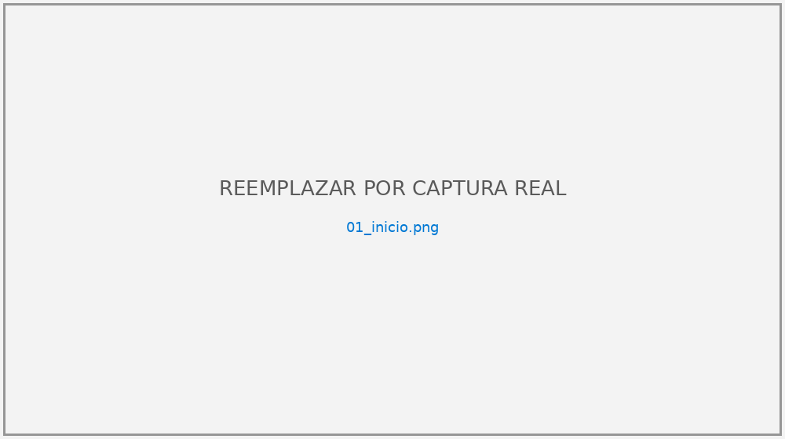

**Libros**
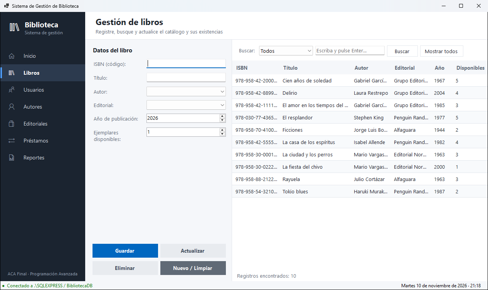

**Autores**
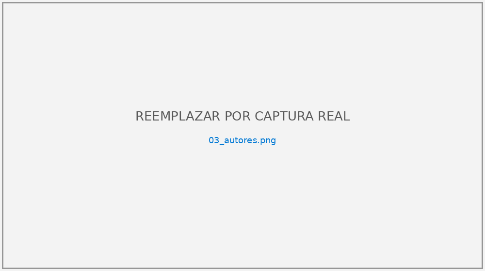

**Editoriales**
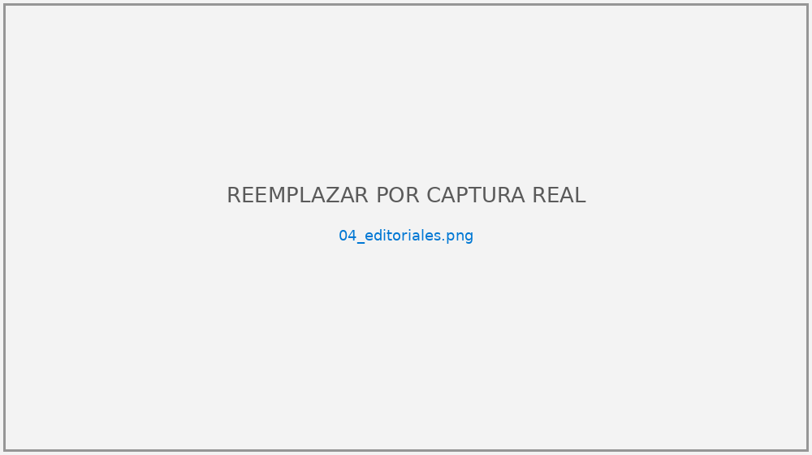

**Usuarios**
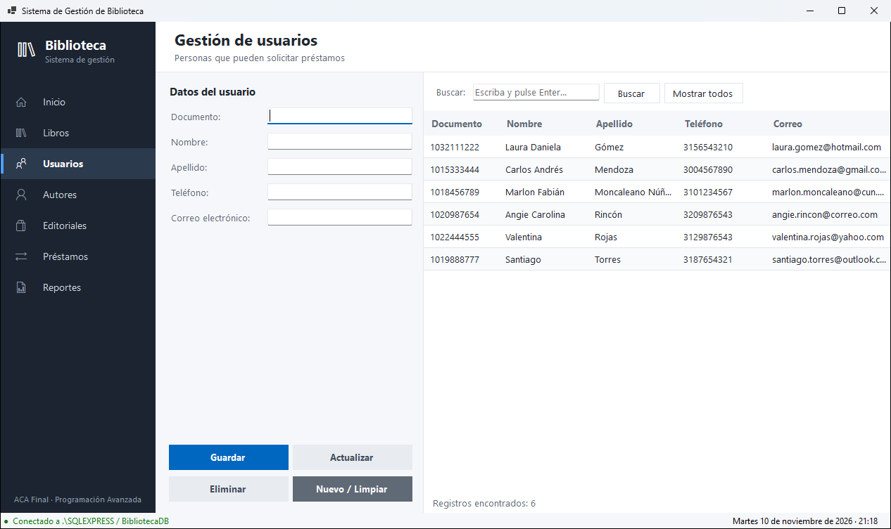

**Préstamos**
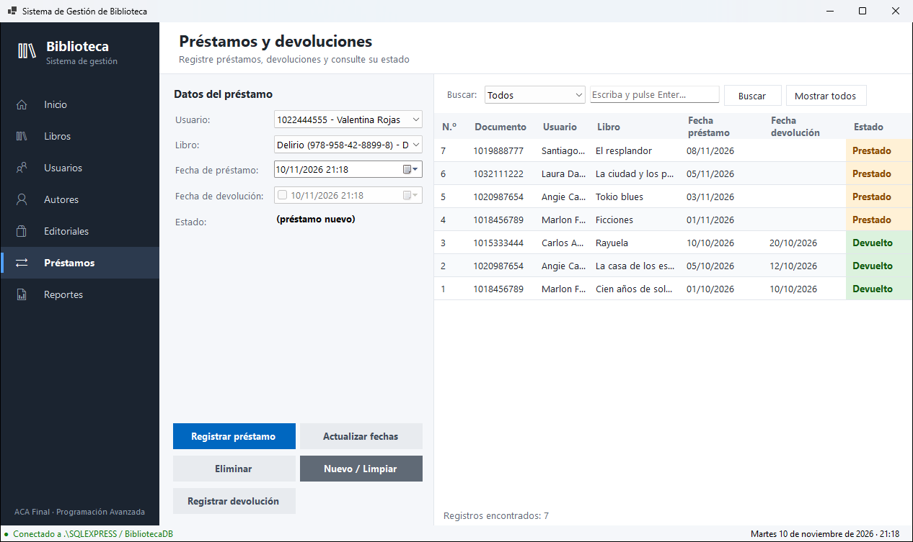

**Registro de una devolución (confirmación)**
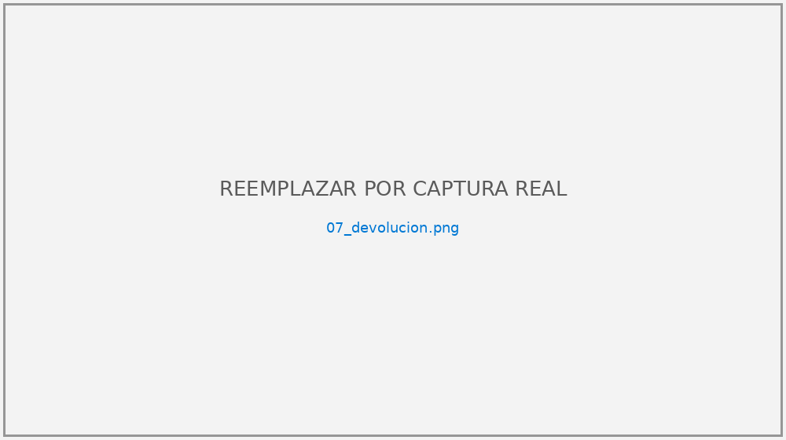

**Reportes**
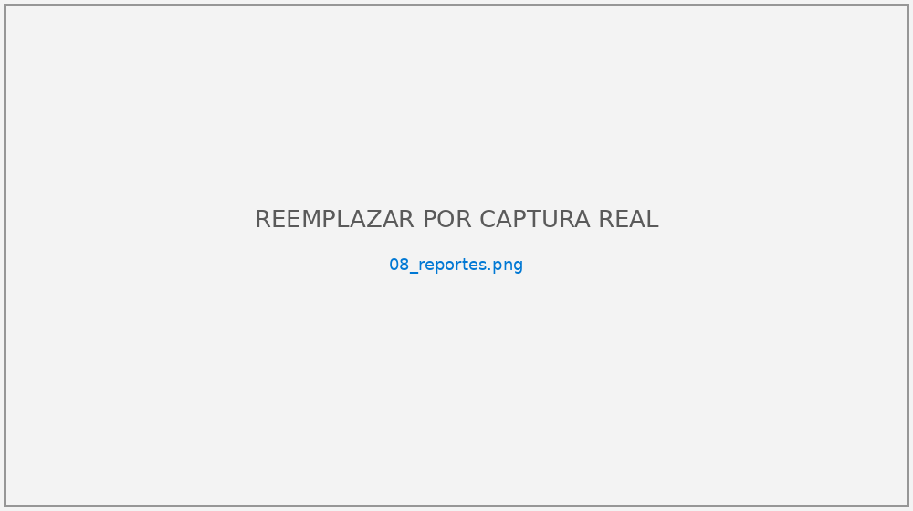

**Mensaje de validación**
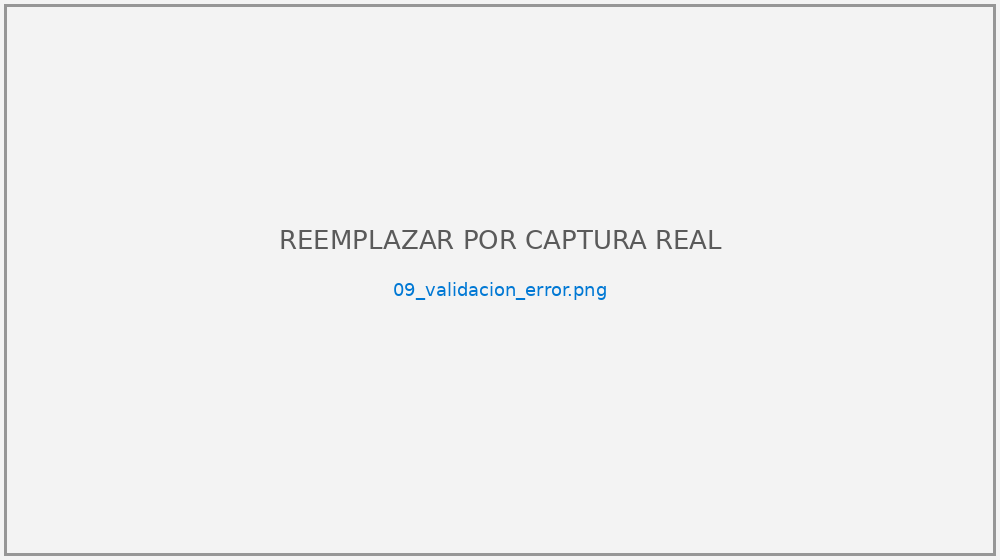

**Base de datos en SQL Server (tablas, filas, restricciones y vistas consultadas con `sqlcmd`)**
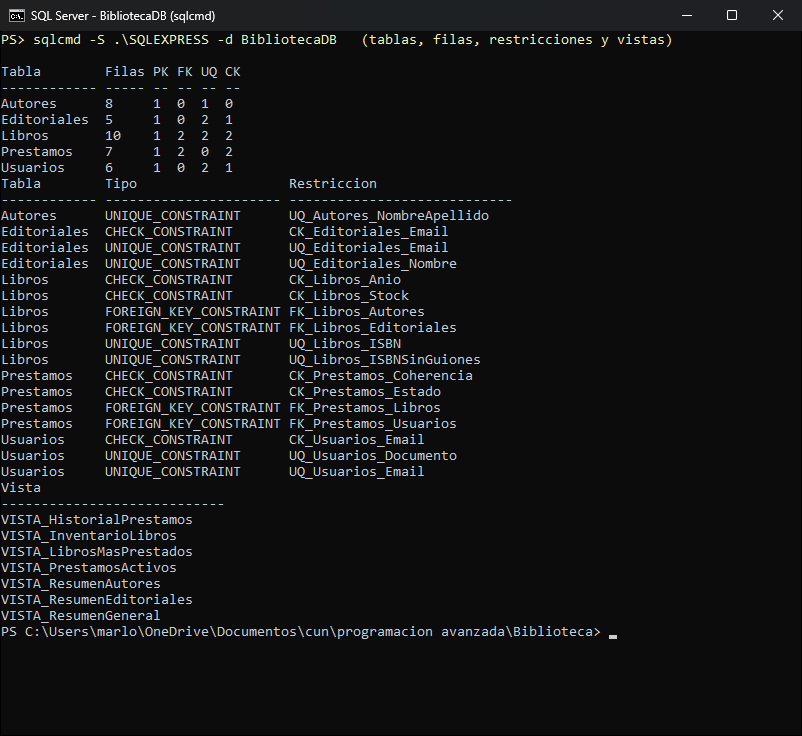

## 14. Pruebas de funcionamiento

### 14.1 Pruebas automáticas (proyecto `BibliotecaApp.Pruebas`)

El proyecto de pruebas referencia al proyecto principal y prueba sus clases reales. Tiene dos modos:

- `dotnet run --project BibliotecaApp.Pruebas` → 27 pruebas que **no requieren base de datos** (validaciones, entidades y reglas de préstamo que se rechazan antes de llegar a SQL Server).
- `dotnet run --project BibliotecaApp.Pruebas -- bd` → las 27 anteriores **más 16 contra `BibliotecaDB`** (préstamos, devoluciones, stock, duplicados e integridad referencial). Estas crean sus propios datos y los borran al terminar.

Resultado de la última ejecución (10/11/2026, con SQL Server Express): **43 de 43 pruebas aprobadas**.

**Validaciones y entidades**

| N.º | Prueba | Resultado |
|---|---|---|
| 1 | Nombre válido con tilde y espacios se acepta y se limpia | Aprobada |
| 2 | Nombre con dígitos es rechazado | Aprobada |
| 3 | Campo obligatorio vacío es rechazado | Aprobada |
| 4 | Longitud máxima excedida es rechazada | Aprobada |
| 5 | Correo válido se acepta | Aprobada |
| 6 | Correo sin dominio válido es rechazado | Aprobada |
| 7 | Teléfono válido (se quitan espacios) | Aprobada |
| 8 | Teléfono demasiado corto es rechazado | Aprobada |
| 9 | Documento numérico válido | Aprobada |
| 10 | Documento con letras es rechazado | Aprobada |
| 11 | ISBN del script de datos es válido | Aprobada |
| 12 | ISBN con X final se normaliza a mayúscula | Aprobada |
| 13 | ISBN corto es rechazado | Aprobada |
| 14 | Entero fuera de rango es rechazado | Aprobada |
| 15 | Lista desplegable sin selección es rechazada | Aprobada |
| 16 | Polimorfismo: `Autor.Describir()` | Aprobada |
| 17 | Polimorfismo: `Usuario.ToString()` | Aprobada |
| 18 | Libro con stock 0 no tiene existencias | Aprobada |
| 19 | Un préstamo nuevo inicia en estado «Prestado» | Aprobada |

**Reglas de negocio sin base de datos**

| N.º | Prueba | Resultado |
|---|---|---|
| 20 | Préstamo sin usuario es rechazado | Aprobada |
| 21 | Préstamo sin libro es rechazado | Aprobada |
| 22 | Préstamo con fecha futura es rechazado | Aprobada |
| 23 | Devolución con fecha futura es rechazada | Aprobada |
| 24 | Devolución anterior al préstamo es rechazada | Aprobada |
| 25 | La búsqueda LIKE escapa los comodines `%`, `_` y `[` | Aprobada |
| 26 | Un error de SQL Server en inglés se asocia a la restricción exacta | Aprobada |
| 27 | Un error de SQL Server en español (comillas dobles) se reconoce | Aprobada |

**Contra `BibliotecaDB` (argumento `bd`)**

| N.º | Prueba | Resultado |
|---|---|---|
| 28 | Autor duplicado (sin distinguir mayúsculas) es rechazado | Aprobada |
| 29 | ISBN repetido escrito sin guiones es rechazado | Aprobada |
| 30 | Registrar préstamo descuenta una unidad (2 → 1) | Aprobada |
| 31 | Mismo libro activo para el mismo usuario es rechazado | Aprobada |
| 32 | Cuarto préstamo activo del usuario es rechazado (máximo 3) | Aprobada |
| 33 | Préstamo de un libro sin existencias es rechazado | Aprobada |
| 34 | Un préstamo rechazado no cambia el stock | Aprobada |
| 35 | Registrar devolución repone la unidad (1 → 2) | Aprobada |
| 36 | Devolver dos veces el mismo préstamo es rechazado | Aprobada |
| 37 | La segunda devolución no infla el stock | Aprobada |
| 38 | Eliminar un préstamo activo repone el stock (0 → 1) | Aprobada |
| 39 | Actualizar un libro con un stock desactualizado es rechazado | Aprobada |
| 40 | …y no modifica el stock | Aprobada |
| 41 | Actualizar con el stock vigente sí guarda (2 → 5) | Aprobada |
| 42 | Eliminar un usuario con préstamos es rechazado | Aprobada |
| 43 | Eliminar un autor con libros es rechazado | Aprobada |

### 14.2 Pruebas funcionales con la aplicación y la base de datos

**Cómo se ejecutaron.** El 10/11/2026 se recorrieron los 23 casos sobre la aplicación en ejecución (Windows 11, .NET 10, SQL Server Express), partiendo de los datos del script. La interfaz se manejó con *UI Automation* de Windows, igual que lo haría un usuario: se escribieron los datos en los campos, se pulsaron los botones y **se leyó el texto real del mensaje mostrado**, que se guardó como imagen en [`docs/pruebas/`](docs/pruebas). Cuando el caso cambia existencias o estados, el resultado también se comprobó con una consulta directa a SQL Server. El registro completo está en [`docs/pruebas/resultados_pruebas_funcionales.csv`](docs/pruebas/resultados_pruebas_funcionales.csv). Al terminar, la base se volvió a crear con el script.

**Resultado: 23 de 23 aprobadas** (PF23 de forma simulada; ver la nota del caso).

| ID | Módulo | Caso de prueba | Datos de entrada | Resultado esperado | Resultado obtenido |
|---|---|---|---|---|---|
| PF01 | Autores | Registrar autor válido | Pablo / Neruda / Chilena | Mensaje de éxito; aparece en la tabla | **Aprobada.** «Autor registrado correctamente.» y el autor aparece en la tabla. [Captura](docs/pruebas/PF01_registrar_autor.png) |
| PF02 | Autores | Campo obligatorio vacío | Nombre vacío | Advertencia «El campo 'Nombre' es obligatorio» | **Aprobada.** «El campo 'Nombre' es obligatorio.» [Captura](docs/pruebas/PF02_campo_obligatorio.png) |
| PF03 | Autores | Eliminar autor con libros | Gabriel García Márquez | Advertencia: autor relacionado con libros | **Aprobada.** «Operación no permitida: el autor está relacionado con libros registrados.» [Captura](docs/pruebas/PF03_autor_con_libros.png) |
| PF04 | Editoriales | Correo duplicado | Correo `atencion@planeta.com` (ya registrado en Grupo Editorial Planeta) | Advertencia de correo duplicado | **Aprobada.** «Ya existe una editorial con ese correo electrónico.» [Captura](docs/pruebas/PF04_correo_duplicado.png) |
| PF05 | Usuarios | Documento duplicado | Documento `1018456789` | Advertencia de documento duplicado | **Aprobada.** «Ya existe un usuario registrado con ese documento.» [Captura](docs/pruebas/PF05_documento_duplicado.png) |
| PF06 | Usuarios | Correo inválido | `correo@dominio` | Advertencia de formato de correo | **Aprobada.** «El campo 'Correo electrónico' no tiene un formato de correo válido.» [Captura](docs/pruebas/PF06_correo_invalido.png) |
| PF07 | Usuarios | Eliminar usuario con préstamos | Marlon Moncaleano | Advertencia: usuario con préstamos | **Aprobada.** «Operación no permitida: el usuario tiene préstamos registrados.» [Captura](docs/pruebas/PF07_usuario_con_prestamos.png) |
| PF08 | Libros | Registrar libro válido | ISBN `978-958-00-0000-0`, autor y editorial existentes, año 2020, 3 ejemplares | Mensaje de éxito | **Aprobada.** «Libro registrado correctamente.»; en la base: año 2020, stock 3. [Captura](docs/pruebas/PF08_registrar_libro.png) |
| PF09 | Libros | ISBN duplicado | ISBN `978-958-42-2000-4` | Advertencia de ISBN duplicado | **Aprobada.** «Ya existe un libro con ese ISBN (escrito con o sin guiones).» [Captura](docs/pruebas/PF09_isbn_duplicado.png) |
| PF10 | Libros | Año futuro | Año mayor al actual | El control numérico no lo permite; la capa de negocio lo rechaza | **Aprobada.** Se escribió 2035 y al salir del campo el control quedó en 2026 (año actual). La regla de `LibroBLL` no se puede forzar desde la interfaz, porque el control ya lo impide. |
| PF11 | Libros | Buscar por título | Criterio Título, texto `soledad` | Se muestra «Cien años de soledad» | **Aprobada.** 1 registro: «Cien años de soledad». [Captura](docs/pruebas/PF11_buscar_titulo.png) |
| PF12 | Libros | Buscar por autor | Criterio Autor, texto `Borges` | Se muestra «Ficciones» | **Aprobada.** 1 registro: «Ficciones». [Captura](docs/pruebas/PF12_buscar_autor.png) |
| PF13 | Libros | Eliminar libro con préstamo activo | «Ficciones» | Advertencia: tiene préstamos activos | **Aprobada.** «No se puede eliminar el libro: tiene 1 préstamo(s) activo(s).» [Captura](docs/pruebas/PF13_libro_con_prestamo.png) |
| PF14 | Préstamos | Registrar préstamo | Usuario 6 (Valentina Rojas), libro «Delirio» | Préstamo «Prestado»; stock de Delirio baja de 4 a 3 | **Aprobada.** «Préstamo registrado correctamente…»; estado «Prestado»; stock de Delirio 4 → 3. [Captura](docs/pruebas/PF14_registrar_prestamo.png) |
| PF15 | Préstamos | Libro sin existencias | Reducir a 0 el stock de un libro y prestarlo | Advertencia: sin existencias disponibles | **Aprobada.** «La fiesta del chivo» se puso en 0 y al prestarlo: «El libro seleccionado no cuenta con existencias disponibles.» [Captura](docs/pruebas/PF15_sin_existencias.png) |
| PF16 | Préstamos | Máximo de préstamos | Registrar 3 préstamos activos a un mismo usuario y solicitar un cuarto | Advertencia de máximo de 3 préstamos | **Aprobada.** Los 3 préstamos de Carlos Mendoza se registraron; el cuarto: «El usuario alcanzó el máximo de 3 préstamos activos…» [Captura](docs/pruebas/PF16_maximo_prestamos.png) |
| PF17 | Préstamos | Libro repetido | Usuario 1 pide «Ficciones» otra vez | Advertencia: ya tiene prestado ese libro | **Aprobada.** «El usuario ya tiene prestado este libro y aún no lo ha devuelto.» [Captura](docs/pruebas/PF17_libro_repetido.png) |
| PF18 | Devoluciones | Registrar devolución | Seleccionar préstamo activo → Registrar devolución | Estado «Devuelto», fecha asignada, stock +1 | **Aprobada.** «Devolución registrada…»; en la base: «Devuelto» con fecha y hora; stock de Delirio 3 → 4. [Mensaje](docs/pruebas/PF18_registrar_devolucion.png) · [Tabla](docs/pruebas/PF18_tabla_tras_devolucion.png) |
| PF19 | Devoluciones | Devolver dos veces | Intentar devolver un préstamo ya devuelto | Botón deshabilitado; si se fuerza, advertencia | **Aprobada.** Con el préstamo devuelto seleccionado, «Registrar devolución» está deshabilitado. El caso forzado lo cubre la prueba automática 36. [Captura](docs/pruebas/PF19_boton_deshabilitado.png) |
| PF20 | Préstamos | Eliminar préstamo activo | Eliminar un préstamo «Prestado» | Préstamo eliminado y stock +1 | **Aprobada.** Se pidió confirmación, se eliminó el préstamo y el stock de Rayuela pasó de 2 a 3. [Captura](docs/pruebas/PF20_eliminar_prestamo_activo.png) |
| PF21 | Reportes | Resumen consolidado | Seleccionar el reporte | Totales coherentes con las tablas | **Aprobada.** Los 7 totales coinciden con conteos hechos directamente sobre las tablas. [Captura](docs/pruebas/PF21_resumen_consolidado.png) |
| PF22 | Reportes | Exportar CSV | Exportar «Historial de préstamos» | Archivo `.csv` que abre correctamente en Excel | **Aprobada.** «Reporte exportado correctamente.»; el archivo tiene 10 filas más el encabezado, UTF-8 con BOM y separador `;`. Excel lo abrió con 11 filas × 8 columnas. [Captura](docs/pruebas/PF22_exportar_csv.png) |
| PF23 | Conexión | SQL Server apagado | Detener el servicio y abrir la aplicación | Advertencia clara y estado «Sin conexión» | **Aprobada (simulada).** No se detuvo el servicio: la cadena de conexión del ejecutable se apuntó a una instancia inexistente. A los ~11 s apareció «No se pudo conectar con SQL Server…», la barra de estado mostró «Sin conexión» e Inicio explicó la causa, sin que la aplicación se cerrara. [Advertencia](docs/pruebas/PF23_sin_conexion.png) · [Barra de estado](docs/pruebas/PF23_barra_estado_sin_conexion.png) |

## 15. Control de versiones con Git y GitHub

El proyecto se gestiona con Git y se publica en GitHub. El repositorio contiene el código fuente (`BibliotecaApp/`), las pruebas, el script SQL (`sql/`), el `README.md` con instrucciones de ejecución, la documentación, los diagramas y las capturas de pantalla (`docs/`).

La guía [`GUIA_GIT.md`](GUIA_GIT.md) describe el flujo de trabajo. El historial se consulta con `git log --oneline --graph` y en la pestaña *Commits* del repositorio en GitHub.

El repositorio se creó cuando el proyecto ya tenía un primer avance, por eso el **primer commit** guarda el proyecto tal como estaba en ese momento. A partir de ahí, cada mejora tiene su propio commit con un mensaje que explica el cambio y su motivo:

| Etapa | Commits (mensaje resumido) |
|---|---|
| Estado inicial | `chore: estado inicial recibido` |
| Corrección de errores críticos | `build: migra a .NET 10 y corrige el csproj de pruebas` · `fix(bd): conexion a .\SQLEXPRESS y fechas ISO en el script` · `fix(ui): botones, seleccion inicial, combos y tarjetas de inicio` · `docs: enlaza el repositorio real de GitHub` |
| Robustez de la lógica | `fix(prestamos): reglas dentro de la transaccion y rollback protegido` · `feat(bd): evita autores duplicados e ISBN repetidos con o sin guiones` · `feat(libros): control de existencias y filtros que se aplican solos` · `test: pruebas de reglas de prestamo y pruebas contra SQL Server` |
| Rediseño visual | `feat(ui): Tema con colores, fuentes y estilos compartidos` · `feat(ui): rediseno visual de la navegacion, modulos e inicio` |
| Pruebas funcionales | `test: resultados reales de las pruebas funcionales PF01-PF23` |
| Documentación | `docs: capturas reales y documentacion actualizada` |

**Enlace del repositorio:** [https://github.com/moncaleanomarlon-stack/ACA-Programacion-Avanzada](https://github.com/moncaleanomarlon-stack/ACA-Programacion-Avanzada)

## 16. Conclusiones

- La arquitectura por capas permitió que los formularios no contengan SQL y que las reglas de negocio se prueben sin base de datos, lo que facilitó el mantenimiento y las pruebas automáticas.
- Las **transacciones** en préstamos y devoluciones garantizan que el inventario nunca quede inconsistente, incluso si ocurre un error a mitad de la operación.
- Combinar validaciones en la capa de negocio con restricciones en SQL Server (`UNIQUE`, `CHECK`, claves foráneas) da doble protección de la integridad: la aplicación informa con mensajes claros y la base de datos impide datos inválidos aunque se acceda por otra vía.
- La herencia (`Persona`, `FormCrudBase`) y el polimorfismo redujeron el código repetido: cinco módulos comparten una misma estructura de interfaz y manejo de errores.
- Las consultas parametrizadas eliminan el riesgo de inyección SQL.
- Ejecutar el sistema y probarlo en un equipo real fue indispensable. Varios errores solo aparecieron así: el script fallaba con fechas en un servidor en español, el botón «Registrar devolución» quedaba oculto, los módulos abrían con un registro ya seleccionado y el proyecto de pruebas no compilaba. Todos se corrigieron y quedaron cubiertos por las pruebas de la sección 14.

## 17. Recomendaciones

- Agregar **autenticación y roles** (administrador y bibliotecario) con contraseñas almacenadas con hash.
- Implementar **fecha límite de devolución, multas y renovaciones** de préstamos.
- Permitir **varios libros por préstamo** mediante una tabla `DetallePrestamos`.
- Generar reportes en **PDF o Excel** con gráficos.
- Usar una **base de datos exclusiva para pruebas**, para que las pruebas automáticas contra SQL Server no compartan la base de trabajo.
- Mostrar los errores de validación **junto al campo** (`ErrorProvider`) además del mensaje emergente.
- Probar la interfaz con el **escalado de pantalla de Windows al 125–150 %**, habitual en portátiles (en esta versión solo se probó al 100 %).
- Mover la cadena de conexión a variables de entorno o a un almacén seguro de secretos al desplegar en producción.
- Hacer copias de seguridad periódicas de `BibliotecaDB`.

## 18. Referencias bibliográficas

Date, C. J. (2019). *Introducción a los sistemas de bases de datos* (8.ª ed.). Pearson Educación.

Elmasri, R., & Navathe, S. B. (2016). *Fundamentals of database systems* (7th ed.). Pearson.

Microsoft. (2024a). *C# documentation*. Microsoft Learn. https://learn.microsoft.com/dotnet/csharp/

Microsoft. (2024b). *Windows Forms documentation for .NET*. Microsoft Learn. https://learn.microsoft.com/dotnet/desktop/winforms/

Microsoft. (2024c). *Microsoft.Data.SqlClient namespace*. Microsoft Learn. https://learn.microsoft.com/dotnet/api/microsoft.data.sqlclient

Microsoft. (2024d). *SQL Server documentation*. Microsoft Learn. https://learn.microsoft.com/sql/sql-server/

Chacon, S., & Straub, B. (2014). *Pro Git* (2nd ed.). Apress. https://git-scm.com/book/es/v2

Martin, R. C. (2018). *Clean architecture: A craftsman's guide to software structure and design*. Prentice Hall.
