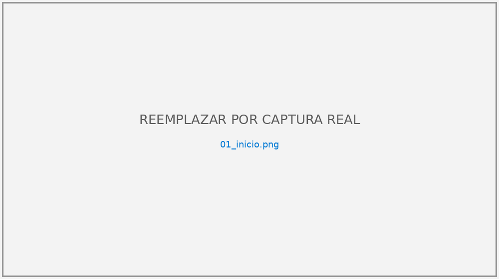

# Sistema de Gestión de Biblioteca

Aplicación de escritorio desarrollada en **C# (Windows Forms, .NET 10)** y **SQL Server** para administrar libros, autores, editoriales, usuarios, préstamos y devoluciones, con módulo de reportes.

> Proyecto ACA Final — Programación Avanzada (2026) · CUN · Ingeniería de Sistemas
> Autor: Marlon Fabián Moncaleano Núñez



## Características

- Módulos: **Inicio, Libros, Usuarios, Autores, Editoriales, Préstamos y Reportes**, con menú lateral desde `FormPrincipal`. En Inicio, cada indicador abre su módulo y hay accesos rápidos.
- CRUD completo de libros, autores, editoriales y usuarios, con búsqueda (libros por **ISBN, título o autor**).
- Préstamos y devoluciones con **transacciones SQL**: al prestar se descuenta el stock y al devolver se repone. No se puede devolver dos veces ni prestar sin existencias.
- Reglas de negocio: máximo 3 préstamos activos por usuario y no repetir un libro activo para el mismo usuario, verificadas dentro de la transacción. Tampoco se aceptan autores ni ISBN duplicados (con o sin guiones).
- 9 reportes (resumen, libros, autores, editoriales, usuarios, préstamos activos y devueltos, historial, más prestados) con **exportación a CSV**.
- Arquitectura por capas (Presentación → Lógica de negocio → Acceso a datos → SQL Server) más una capa de Entidades (POO).
- Consultas **100 % parametrizadas**, validación de datos y manejo de excepciones con mensajes claros.
- Interfaz con estilos comunes (`Tema`), estado de los préstamos con color, atajos de teclado (F5, Ctrl+N, Ctrl+G, Supr) y ayudas emergentes.
- **43 pruebas automáticas** y **23 pruebas funcionales** ejecutadas sobre la aplicación, con evidencias en [`docs/pruebas`](docs/pruebas).

## Estructura del repositorio

```
BibliotecaApp.sln
BibliotecaApp/                 Proyecto principal (Windows Forms)
  Entidades/                   Persona (abstracta), Autor, Usuario, Editorial, Libro, Prestamo
  AccesoDatos/                 ConexionBD y un DAL por entidad (+ ReporteDAL)
  LogicaNegocio/               Validador y un BLL por módulo
  Presentacion/                Formularios (FormCrudBase es la base de los CRUD) y Tema (estilos)
  App.config                   Cadena de conexión
BibliotecaApp.Pruebas/         Pruebas automáticas (validaciones, reglas y, con "bd", contra SQL Server)
sql/Script_Biblioteca_Completo.sql   Base de datos, restricciones, datos de prueba y vistas
docs/                          Diagramas (ER, clases, casos de uso, capas), capturas y evidencias de pruebas
DOCUMENTACION.md / .docx         Documento técnico del proyecto (Markdown y Word)
Informe Bbiblioteca app.pdf      Documento técnico en PDF
GUIA_GIT.md                    Flujo de trabajo con Git
herramientas/                  Generan DOCUMENTACION.pdf y DOCUMENTACION.docx a partir del Markdown (ver herramientas/README.md)
```

## Requisitos

- Windows 10/11
- [.NET 10 SDK](https://dotnet.microsoft.com/download/dotnet/10.0), o Visual Studio con la carga de trabajo *Desarrollo de escritorio de .NET* y soporte para .NET 10
- SQL Server 2019/2022 (Developer, Express o LocalDB). SQL Server Management Studio es opcional: el script también se puede ejecutar con `sqlcmd`.

## Instrucciones de ejecución

1. Clonar el repositorio:
   ```bash
   git clone https://github.com/moncaleanomarlon-stack/ACA-Programacion-Avanzada.git
   cd ACA-Programacion-Avanzada
   ```
2. Ejecutar **completo** `sql/Script_Biblioteca_Completo.sql`, que crea `BibliotecaDB`, las tablas, los datos de prueba y las vistas. Puede hacerse en SSMS o desde consola:
   ```bash
   sqlcmd -S .\SQLEXPRESS -E -C -i sql/Script_Biblioteca_Completo.sql
   ```
   > **Atención:** si `BibliotecaDB` ya existe, el script la **borra y la vuelve a crear**, de modo que se pierden los datos registrados.
3. La cadena de conexión de `BibliotecaApp/App.config` usa `Server=.\SQLEXPRESS`. Si su instalación es otra, ajuste `Server`:

   | Instalación | Server |
   |---|---|
   | SQL Server Express (valor actual) | `.\SQLEXPRESS` |
   | Instancia por defecto | `localhost` |
   | LocalDB | `(localdb)\MSSQLLocalDB` |

4. Abrir `BibliotecaApp.sln` en Visual Studio y pulsar **F5**, o desde consola:
   ```bash
   dotnet run --project BibliotecaApp
   ```
5. (Opcional) Ejecutar las pruebas automáticas. Sin argumentos no requieren base de datos
   (validaciones, entidades y reglas de préstamo):
   ```bash
   dotnet run --project BibliotecaApp.Pruebas
   ```
   Con el argumento `bd` además prueban préstamos, devoluciones, stock y duplicados contra
   `BibliotecaDB`; crean sus propios datos y los borran al terminar:
   ```bash
   dotnet run --project BibliotecaApp.Pruebas -- bd
   ```

La barra de estado de la ventana principal indica si la conexión con SQL Server fue exitosa.

## Capturas de pantalla

Ver la carpeta [`docs/capturas`](docs/capturas) y la sección 13 de [`DOCUMENTACION.md`](DOCUMENTACION.md).

## Documentación

El documento técnico completo (requerimientos, casos de uso, diagrama de clases, modelo E-R, diccionario de datos, arquitectura, pruebas, conclusiones y referencias APA) está en [`DOCUMENTACION.md`](DOCUMENTACION.md), en [`Informe Bbiblioteca app.pdf`](Informe%20Bbiblioteca%20app.pdf) y en Word, [`DOCUMENTACION.docx`](DOCUMENTACION.docx), editable, con tabla de contenido automática. Las versiones PDF y Word tienen numeración de páginas.
